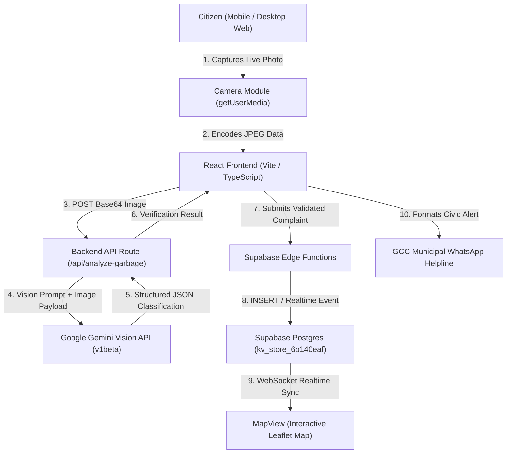
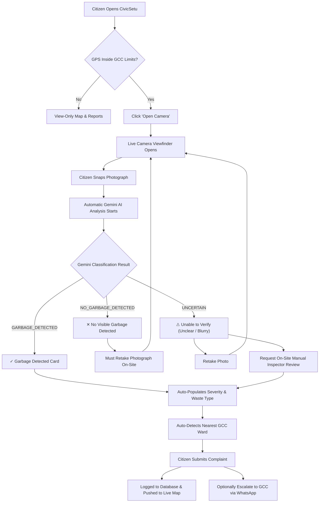
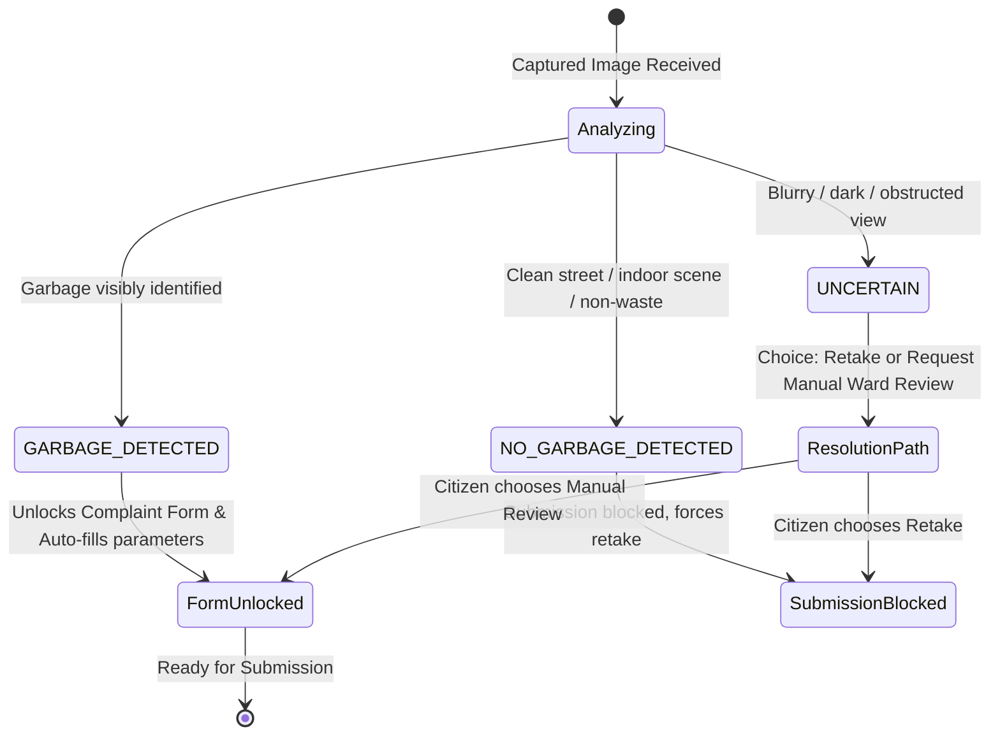

# CivicSetu

> **AI-Powered Civic Reporting & Real-Time Garbage Verification Platform**

[](https://civicsetu-platform.vercel.app)
[](LICENSE)
[](https://www.typescriptlang.org/)
[](https://ai.google.dev/)
[](https://supabase.com/)

---

## 1. Project Overview

**CivicSetu** is an AI-powered civic technology platform built to address the challenges of municipal solid waste management, illegal dumping, and civic accountability. 

By combining citizen participation with automated **Google Gemini AI image verification**, CivicSetu eliminates fraudulent and irrelevant civic complaints while ensuring legitimate waste-related issues are instantly analyzed, categorized, and routed to the responsible municipal ward officials.

- **Target Audience:** Citizens reporting public sanitation issues, Greater Chennai Corporation (GCC) ward councillors, and municipal sanitary inspectors.
- **Role of AI:** Google Gemini Vision models act as an automated civic verification layer—verifying whether visible garbage exists in a live photograph, classifying waste categories (plastic, organic, construction debris), estimating severity, and providing objective observations before complaints are logged.

---

## 2. Problem Statement

Municipal corporations handle thousands of citizen grievances daily. However, civic reporting portals frequently face critical bottlenecks:
1. **Spam & False Submissions:** Reports containing irrelevant images, indoor scenes, or outdated screenshots uploaded from photo galleries overwhelm municipal workers.
2. **Ambiguous Descriptions:** Citizens often struggle to describe the volume, category, or severity of garbage heaps accurately, delaying appropriate dispatch (e.g., sending an auto-rickshaw when a JCB is required).
3. **Lack of Ward Accountability:** Complaints are frequently lodged without precise administrative context, leaving ward councillors and sanitary inspectors disconnected from hyper-local problem areas.

---

## 3. Proposed Solution

CivicSetu provides a camera-first civic reporting workflow:

1. **Mandatory Live Camera Capture:** Gallery uploads and stored file selections are completely disabled. Citizens must capture authentic, real-time photographs on-site.
2. **Automatic Gemini AI Verification:** As soon as a photo is captured, Gemini Vision models automatically analyze the image, classify waste, and assess severity without requiring manual button clicks.
3. **Structured Verification Gate:** Only verified garbage photographs proceed to submission. Irrelevant photos are rejected with constructive guidance, while ambiguous images provide an option for on-site manual inspector review.
4. **Geospatial & Ward Association:** Automatically resolves coordinates into Greater Chennai Corporation's 200 wards and 15 administrative zones, identifying the local councillor, MLA, and Zonal Officer.
5. **Real-Time Civic Map:** An interactive OpenStreetMap layer powered by Supabase Realtime renders live citizen reports and ward status updates.

---

## 4. Key Features

- 📷 **Live Camera Capture Only:** Native `navigator.mediaDevices.getUserMedia` integration with camera switching (front/back), live framing guides, and graceful permission handling.
- 🤖 **Automatic Gemini AI Image Verification:** Sub-second vision analysis assessing waste presence, material category, heap volume, condition (scattered vs. accumulated), and environmental risks.
- 🗺️ **Interactive Real-Time Map:** Leaflet/OpenStreetMap rendering of citizen reports, severity heat zones, and active status indicators.
- 🏛️ **Chennai Ward Intelligence:** Pre-mapped dataset of all 15 GCC Zones, 200 Wards, elected councillors, MLAs, and Zonal Officers.
- 📲 **Official GCC WhatsApp Escalation:** Generates formatted civic alerts with GPS coordinates, ward numbers, and AI verification tags for direct escalation.
- 🌐 **Bilingual Interface:** Full Tamil (`தமிழ்`) and English language toggle with persistent preferences.
- 📊 **Ward Leaderboard & Analytics:** Aggregates worst-affected wards and resolution ratios to promote civic transparency and administrative accountability.
- 🛡️ **Municipal Admin & Ward Officer Console:** Secure administrative portal (`/admin`) with metrics, ward-wise allocation, complaint status lifecycle management (Submitted → In Progress → Resolved), and filter controls.

---

## 5. System Architecture

The following diagram illustrates the architecture of CivicSetu:



---

## 6. Citizen Reporting Workflow

The complete end-to-end citizen journey from camera to complaint resolution:



---

## 7. AI Decision Flow & Classification Logic

Gemini analyzes the image against municipal criteria and returns one of three discrete outcomes:



### Classification Details

| Classification | Verification Status | Allowed Action | UI Representation |
|---|---|---|---|
| **GARBAGE_DETECTED** | Verified | Allowed to proceed to complaint submission | Green verification card, category tags, severity pill, and AI observations. |
| **NO_GARBAGE_DETECTED** | Rejected | Submission blocked; must capture actual waste | Red warning card explaining that no garbage was detected. |
| **UNCERTAIN** | Needs Review | Retake recommended; manual review escalation available | Amber caution card explaining photographic insufficiency with escalation option. |

---

## 8. Technology Stack

- **Frontend Framework:** React 18 with TypeScript and Vite
- **Styling:** Tailwind CSS, Radix UI primitives, Lucide React icons
- **Mapping & Geospatial:** Leaflet, React Leaflet, OpenStreetMap
- **Artificial Intelligence:** Google Gemini Vision Models (`gemini-3.5-flash-lite`, `gemini-3.1-flash-lite`, `gemini-3.8-flash`)
- **Backend & Serverless:** Vercel Serverless Functions (`/api/analyze-garbage`) & Supabase Edge Functions (Deno / Hono)
- **Database & Realtime:** Supabase PostgreSQL with Row Level Security (RLS) & WebSockets
- **Testing:** Node.js Native Test Runner (`node:test`, `node:assert`)
- **Hosting:** Vercel Production Platform

---

## 9. Project Structure

```
civicsetu/
├── .env.example                     # Environment variables template
├── .gitignore                       # Git exclusion rules
├── api/
│   └── analyze-garbage.ts          # Vercel serverless function for Gemini Vision AI
├── public/                          # Static assets and icons
├── src/
│   ├── assets/                      # Application assets (GCC municipal logo)
│   ├── app/
│   │   ├── components/
│   │   │   ├── AdminDashboard.tsx  # GCC Municipal Officer & Ward Console
│   │   │   ├── api.ts              # Frontend client for backend APIs
│   │   │   ├── ComplaintDetail.tsx # Complaint view and cleanup verification
│   │   │   ├── ComplaintsContext.tsx# Supabase Realtime complaints state
│   │   │   ├── data.ts             # Chennai GCC Wards dataset & helpers
│   │   │   ├── HomeScreen.tsx      # Main responsive map & reports screen
│   │   │   ├── Layout.tsx          # App container & navigation bar
│   │   │   ├── ListView.tsx        # Filterable list of civic complaints
│   │   │   ├── LocationContext.tsx # Citizen GPS & GCC boundary enforcement
│   │   │   ├── MapView.tsx         # Leaflet interactive map implementation
│   │   │   ├── QRCode.tsx          # QR Code generator for mobile handoff
│   │   │   ├── ReportScreen.tsx    # Live camera capture & Gemini verification
│   │   │   ├── WorstWards.tsx      # Ward leaderboard & civic analytics
│   │   │   └── ui/                 # Reusable UI component library
│   │   ├── App.tsx                 # Root React component
│   │   └── routes.tsx              # Application route definitions
│   └── main.tsx                    # React DOM entry point
├── supabase/
│   └── functions/
│       └── make-server-6b140eaf/   # Supabase Deno Edge Function API
├── tests/
│   ├── camera-workflow.test.mjs    # Camera error handling & lifecycle tests
│   ├── complaint-flow.test.mjs     # Complaint generation & formatting tests
│   ├── gemini-analysis.test.mjs    # Gemini schema parser & classification tests
│   └── ward-location.test.mjs      # GPS & Chennai GCC ward mapping tests
├── package.json                    # Project metadata, dependencies, scripts
├── tsconfig.json                   # TypeScript configuration
├── vercel.json                     # Vercel routing and header rules
└── vite.config.ts                  # Vite build tool configuration
```

---

## 10. Getting Started

### Prerequisites

- Node.js `20.x` or `22.x` installed
- A Google Gemini API key ([Google AI Studio](https://aistudio.google.com/))
- A Supabase project with database enabled ([Supabase](https://supabase.com/))

### Installation

1. **Clone the repository:**
   ```bash
   git clone https://github.com/ashubrothaaa007/usecivicsetu.git
   cd usecivicsetu
   ```

2. **Install dependencies:**
   ```bash
   npm install
   ```

3. **Configure environment variables:**
   ```bash
   cp .env.example .env.local
   ```
   Open `.env.local` and add your credentials:
   ```env
   GEMINI_API_KEY=your_gemini_api_key_here
   VITE_SUPABASE_URL=https://your-project.supabase.co
   VITE_SUPABASE_ANON_KEY=your_supabase_anon_key_here
   ```

4. **Start the development server:**
   ```bash
   npm run dev
   ```

5. **Build for production:**
   ```bash
   npm run build
   ```

6. **Run the automated test suite:**
   ```bash
   npm test
   ```

---

## 11. Environment Variables

| Variable | Scope | Required | Description |
|---|---|---|---|
| `GEMINI_API_KEY` | Backend Serverless | Yes | Private API key for Google Gemini image analysis. Kept secret on server. |
| `VITE_SUPABASE_URL` | Frontend Client | Yes | Supabase project URL for database and realtime websockets. |
| `VITE_SUPABASE_ANON_KEY` | Frontend Client | Yes | Supabase public anon key for reading and submitting complaints. |

> **Security Note:** Private API keys (`GEMINI_API_KEY`) must never be prefixed with `VITE_` or embedded in frontend code.

---

## 12. API Documentation

### 1. Analyze Garbage Image

- **Endpoint:** `POST /api/analyze-garbage` (or Supabase Edge Function `/functions/v1/make-server-6b140eaf/analyze-garbage`)
- **Headers:** `Content-Type: application/json`
- **Request Body:**
  ```json
  {
    "image": "data:image/jpeg;base64,...",
    "mimeType": "image/jpeg"
  }
  ```
- **Response (200 OK):**
  ```json
  {
    "ok": true,
    "data": {
      "garbageDetected": "Yes",
      "wasteCategory": "Plastic and Mixed Waste",
      "mappedWasteType": "Household Waste",
      "estimatedSeverity": "Moderate",
      "quantity": "Medium",
      "condition": "Scattered",
      "environmentalConcerns": "Risk of drain blockage along roadway.",
      "isRelevant": true,
      "observation": "Visible plastic containers and domestic refuse scattered near curb.",
      "confidence": 0.94
    }
  }
  ```

### 2. Fetch Complaints

- **Endpoint:** `GET /functions/v1/make-server-6b140eaf/complaints`
- **Headers:** `Authorization: Bearer <ANON_KEY>`
- **Response (200 OK):**
  ```json
  {
    "complaints": [
      {
        "id": "m1k2l3",
        "area": "Kasimedu",
        "wardNo": 6,
        "wardName": "Kasimedu",
        "severity": "Moderate",
        "status": "Unresolved",
        "wasteType": "Mixed Waste",
        "hasImage": true,
        "lat": 13.1212,
        "lng": 80.2988,
        "submittedAt": 1731976000000,
        "aiVerified": true
      }
    ]
  }
  ```

---

## 13. Security & Validation

- **Credential Isolation:** The Gemini API key is stored exclusively in backend environment variables (`process.env.GEMINI_API_KEY` on Vercel and `Deno.env.get("GEMINI_API_KEY")` on Supabase). Frontend clients communicate through backend proxy routes.
- **Payload Validation:** Inbound images are validated for size (capped at 10MB), permitted MIME types (`image/jpeg`, `image/png`, `image/webp`), and base64 integrity.
- **Database Security:** Supabase table `kv_store_6b140eaf` is secured with Postgres Row Level Security (RLS), restricting updates and protecting public access.
- **Camera Lifecycle Safety:** Media tracks are released immediately upon photo capture, tab switching, or component unmounting to prevent camera resource leaks.

---

## 14. Testing

CivicSetu includes an automated test suite executed via Node.js native test runner:

```bash
npm test
```

### Test Coverage Highlights:
- **`tests/gemini-analysis.test.mjs`:** Tests response parsing for `GARBAGE_DETECTED`, `NO_GARBAGE_DETECTED`, and `UNCERTAIN` results, schema sanitization, and invalid payload rejection.
- **`tests/camera-workflow.test.mjs`:** Tests camera permission denial error mapping (`NotAllowedError`, `NotFoundError`), video track cleanup, and retake state resets.
- **`tests/ward-location.test.mjs`:** Tests GCC boundary enforcement and nearest ward calculation by Euclidean distance.
- **`tests/complaint-flow.test.mjs`:** Tests unique complaint ID generation, relative timestamp calculations, WhatsApp civic message formatting, and worst ward leaderboard aggregations.

---

## 15. Accessibility & Responsiveness

- **Mobile-First Responsive Header:** Two-row responsive layout on mobile viewports (< 768px) with status badges and language switcher separated from filter controls, preventing horizontal overflow.
- **Accessible Touch Targets:** Minimum 48px touch targets for camera shutter, filter triggers, and navigation tabs.
- **Color Contrast & Indicators:** Every status badge combines high-contrast text, background tints, and descriptive icon markers (e.g. `✓`, `✕`, `⚠`) rather than relying solely on color.
- **Semantic HTML & Screen Readers:** Proper ARIA labels on camera triggers, close buttons, and dropdown options.

---

## 16. Limitations

- **Live Camera Requirement:** Desktop devices without connected webcams cannot submit photographs directly and are provided with a QR code to complete the complaint on a smartphone.
- **Geographic Scope:** Location filtering is calibrated specifically for the Greater Chennai Corporation (GCC) limits.
- **Lighting Dependency:** Night photography under severe underexposure may trigger an `UNCERTAIN` classification, for which an on-site manual inspector review option is provided.

---

## 17. Future Roadmap

- [ ] Automated push notifications when complaints are resolved by GCC ward workers.
- [ ] Predictive illegal dumping hotspot detection based on historical complaint recurrence.
- [ ] Integration with Tamil Nadu Government CM Cell & Namma Chennai municipal API.
- [ ] Multi-lingual speech-to-text complaint description input for improved accessibility.

---

## 18. License & Attribution

- **License:** Open-source under the MIT License.
- **Map Data:** © [OpenStreetMap](https://www.openstreetmap.org/copyright) contributors.
- **Civic Data:** Publicly available municipal ward boundaries and elected representative data from Greater Chennai Corporation (GCC) and the Election Commission of India.
